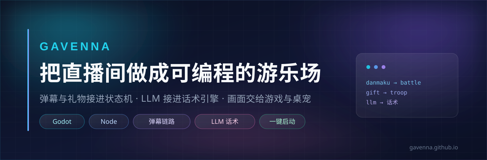

我把直播间做成可编程的游乐场：弹幕和礼物接进状态机，LLM 接进话术引擎，画面交给 Godot。

<!-- STATS-START -->
🛠 12 个公开仓库 · 最近推送 2026-10-25
<!-- STATS-END -->

## 最近在做：直播间互动系统

一个能真的开播的互动游戏，而不是一个演示。

`直播弹幕 → 兵种与阵营 → 战局结算 → 主播话术播报 → OBS 画面`，整条链路在一个仓库里。画面侧是 Godot 客户端，链路侧是 Node 服务端。

它把不确定性也写进了仓库——HANDOVER.md 里分三类记录：

| 分类 | 说明 |
|---|---|
| 已修复 | 逐条带根因，例如「模板插值 `val !== undefined` 不防 null → 改 `val != null` + 残留占位符兜底清除」 |
| assumed（未逐条验证） | 「LLM 话术代码完整但 `LLM_ENABLED=false`，缺 API Key」「真实弹幕/礼物链路未经实际观众验证」 |
| failed_approaches | 走不通的路也留着，避免下一轮重新踩 |

配套还有 PROGRESS.md 与按游戏时间线排的话术验收清单（主播可以对着听）。

[打开 livegame →](https://github.com/gavenna/livegame)

## 从这里开始

### livegame · 直播间互动游戏

Godot 客户端 + Node 服务端 + 弹幕/礼物链路 + LLM 话术引擎 + OBS 挂图。跨平台启动脚本（bat / ps1 / sh）与安装包配置齐全。

`godot/`　`server/`　`frontend/`　`toolbox/`　`setup.iss`

[仓库](https://github.com/gavenna/livegame) · [交接文档](https://github.com/gavenna/livegame/blob/main/HANDOVER.md)

### live_tool · 弹幕战斗工具链

`danmaku/`　`battle/`　`mods/`　`relay.js`　`server/` —— mod 可插拔的弹幕战斗服务，带独立测试入口。

弹幕接进来，battle 模块算，mods 让规则可换。同一套链路既能服务小游戏，也能当战斗逻辑的实验场。

[打开仓库 →](https://github.com/gavenna/live_tool)

## 站点

- **gavenna.github.io** — Hugo 博客，长文与技术笔记
- **resume-site** — 双语简历站：`build.py` 把 Markdown + YAML frontmatter 编成 HTML，零 Node 依赖，Netlify 自动部署，暗色模式 + Intersection Observer 滚动揭示

## 我在每个仓库里都会做的三件事

1. **把"没验证"写出来，而不是装作验证过。** 交接文档里 `assumed` 是独立一节，和"已修复"分开。
2. **I/O 注入，让核心逻辑是纯函数。** 能单测的东西不该被文件系统和网络绑住。
3. **零依赖优先。** 能用标准库就不加包——`resume-site` 的构建链零 Node 依赖。

## 联系

[博客](https://gavenna.github.io) · [全部仓库](https://github.com/gavenna?tab=repositories)
